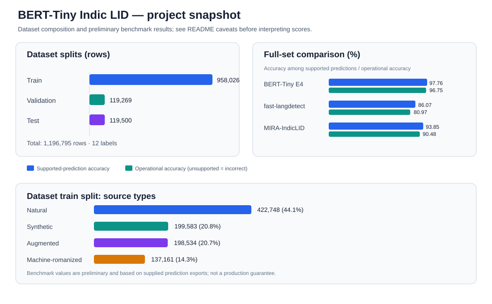

# BERT-Tiny Indic LID

**A 12-class text language-identification model for Indian languages**, including native-script text, romanized writing, and English code-mixing. This repository contains the BERT-Tiny E4 checkpoint, tokenizer, dataset v6, training/evaluation notebooks, benchmark exports, and release documentation.

> **Release status:** artifacts are uploaded to this repository's `main` branch. The repository is currently private. Before making it public, review source-dataset licenses, synthetic-data provenance, benchmark caveats, and the intended repository/model license.

<p align="center">
  
</p>

## Quick links

| Resource | Link |
|---|---|
| **Trained E4 model + tokenizer** | [`model/bert-tiny-e4/`](model/bert-tiny-e4/) |
| Model card | [`docs/model_card.md`](docs/model_card.md) |
| **Dataset v6 files** | [`dataset/`](dataset/) |
| Dataset card | [`docs/dataset_card.md`](docs/dataset_card.md) |
| Dataset statistics | [`docs/dataset_stats.json`](docs/dataset_stats.json) |
| Fine-tuning notebook | [`notebooks/finetuning_bert_e4.ipynb`](notebooks/finetuning_bert_e4.ipynb) |
| Evaluation notebook | [`notebooks/evaluation.ipynb`](notebooks/evaluation.ipynb) |
| Model comparison notebook | [`notebooks/benchmark_comparison.ipynb`](notebooks/benchmark_comparison.ipynb) |
| Benchmark caveats | [`reports/preliminary_benchmark_caveats.md`](reports/preliminary_benchmark_caveats.md) |
| Full-set comparison metrics | [`results/preliminary_full_set_metrics.csv`](results/preliminary_full_set_metrics.csv) |
| BERT vs Sarvam subset metrics | [`results/preliminary_sarvam_subset_metrics.csv`](results/preliminary_sarvam_subset_metrics.csv) |
| Training methodology | [`docs/training_methodology.md`](docs/training_methodology.md) |
| Deployment guide | [`docs/deployment_guide.md`](docs/deployment_guide.md) |

Large dataset files are stored with **Git LFS**. For best results, clone with Git LFS installed and enabled; a browser preview may show an LFS pointer or may not render a large JSONL file inline.

## What this model does

Given a text string, the classifier predicts one of 12 labels. It is designed for language identification, not translation, sentiment, text quality scoring, or content moderation.

The model card describes the checkpoint as a 4-layer `BertForSequenceClassification` model with hidden size 256, 4 attention heads, a 50,000-token WordPiece vocabulary, and approximately **16.1 million parameters**. The released configuration maps 12 output IDs to the labels below.

## Supported labels

| ID | Label | Meaning |
|---:|---|---|
| 0 | `hi-IN` | Hindi |
| 1 | `mr-IN` | Marathi |
| 2 | `bn-IN` | Bengali |
| 3 | `as-IN` | Assamese |
| 4 | `pa-IN` | Punjabi |
| 5 | `gu-IN` | Gujarati |
| 6 | `ta-IN` | Tamil |
| 7 | `te-IN` | Telugu |
| 8 | `kn-IN` | Kannada |
| 9 | `ml-IN` | Malayalam |
| 10 | `en-IN` | English (India) |
| 11 | `none` | Other / unsupported / non-linguistic or ambiguous input, according to the dataset policy |

The target is the language a text is written in, regardless of whether it uses a native script, Latin-script romanization, or English code-mixing. The `none` class is not a universal detector for every language: its coverage is limited by the examples represented in the dataset.

## Model architecture and files

The checkpoint lives in [`model/bert-tiny-e4/`](model/bert-tiny-e4/).

| Property | Value |
|---|---|
| Architecture | `BertForSequenceClassification` |
| Transformer layers | 4 |
| Hidden size | 256 |
| Attention heads | 4 |
| WordPiece vocabulary | 50,000 |
| Output classes | 12 |
| Parameter count | 16,094,476 (about 16.1M) |
| Weights | `model.safetensors` |
| Tokenizer | `tokenizer.json` and `tokenizer_config.json` |

### Local inference

Install the repository dependencies and load the local checkpoint directory. Always set truncation and a maximum length; the model card recommends `max_length=192`.

```bash
git lfs install
git clone https://github.com/abhinavnautiyalDS/bert-tiny-indic-lid.git
cd bert-tiny-indic-lid
pip install -r requirements.txt
```

```python
from transformers import AutoTokenizer, AutoModelForSequenceClassification
import torch

model_dir = "model/bert-tiny-e4"
tokenizer = AutoTokenizer.from_pretrained(model_dir)
model = AutoModelForSequenceClassification.from_pretrained(model_dir)
model.eval()

id2label = {int(k): v for k, v in model.config.id2label.items()}
texts = [
    "मुझे चाय पसंद है",
    "I will call you tomorrow",
    "આજે હું ઘરે જઈશ",
    "ನಾನು ಮನೆಗೆ ಹೋಗುತ್ತಿದ್ದೇನೆ",
]

batch = tokenizer(
    texts, padding=True, truncation=True, max_length=192, return_tensors="pt"
)
with torch.inference_mode():
    probabilities = torch.softmax(model(**batch).logits, dim=-1)

for text, scores in zip(texts, probabilities):
    idx = int(scores.argmax())
    print(f"{text!r} -> {id2label[idx]} (confidence={scores[idx].item():.3f})")
```

Confidence is the model's softmax score, **not a guarantee of correctness or calibrated probability**. The example is a smoke test; it does not constitute an accuracy evaluation.

## Dataset v6

The dataset files and scripts are in [`dataset/`](dataset/). Read the [dataset card](docs/dataset_card.md) before using or redistributing the data.

| Split | Rows |
|---|---:|
| Train | 958,026 |
| Validation | 119,269 |
| Test | 119,500 |
| **Total** | **1,196,795** |

The dataset card describes four train source types:

| Source type | Rows | Share |
|---|---:|---:|
| Natural | 422,748 | 44.1% |
| Synthetic | 199,583 | 20.8% |
| Augmented | 198,534 | 20.7% |
| Machine-romanized | 137,161 | 14.3% |

It includes native scripts, rule-based romanizations, English-mixed examples, noisy and short fragments, and an open-set `none` class. Some data are synthetic, augmented, or automatically romanized and **have not been reviewed by native speakers**. The dataset card also notes that natural rows originate from third-party corpora whose licenses must be checked before redistribution. Do not assume all source data can be freely redistributed simply because the files are present here.

## Preliminary benchmark snapshot

The following figures are transcribed from the current benchmark report and supplied prediction exports. They are **preliminary results, not independently verified production claims**.

### Full-set comparison — 76,268 rows

| Model/export | Coverage | Accuracy on supported predictions | Operational accuracy* | Macro-F1 on supported predictions |
|---|---:|---:|---:|---:|
| **BERT-Tiny E4** | 98.97% | 97.76% | 96.75% | 97.76% |
| fast-langdetect export | 94.07% | 86.07% | 80.97% | 88.11% |
| MIRA-IndicLID export | 96.41% | 93.85% | 90.48% | 88.12% |

`*` Operational accuracy counts unsupported or missing predictions as incorrect across all rows. The other accuracy and macro-F1 values are calculated among supported predictions only.

### Paired BERT vs Sarvam comparison — 3,952 rows

| Model/export | Coverage | Supported-prediction accuracy | Operational accuracy | Macro-F1 |
|---|---:|---:|---:|---:|
| BERT-Tiny E4 | 98.68% | 97.54% | 96.26% | 97.48% |
| Sarvam `/text-lid` API | 95.52% | 95.02% | 90.76% | 87.74% |

The recorded latency percentiles in the supplied exports are not included as speed claims here because their units and timing protocol have not been confirmed.

### Benchmark limitations — please read

- The full-set audit used the MIRA prediction export as a **proxy reference source** because the original held-out ground-truth dataset was not separately supplied in that run.
- The baseline export was identified by its columns as **fast-langdetect**; it has not been confirmed as the original fastText `lid.176` model.
- The MIRA export had no `en-IN` predictions. This may reflect output/wrapper mapping and must be investigated before drawing conclusions about English capability.
- Latency needs a documented unit, hardware, warm-up, batch size, timer placement, and treatment of API/network overhead before any speed comparison.
- High scores on prepared splits should be checked for exact and near-duplicate overlap, template leakage, and source/label leakage.
- These metrics do not establish production superiority or generalization to all real-world speech transcripts.

See the [benchmark caveats](reports/preliminary_benchmark_caveats.md), metric CSVs, and [comparison notebook](notebooks/benchmark_comparison.ipynb) for details.

## Repository layout

```text
bert-tiny-indic-lid/
├── dataset/        # Dataset splits, scripts, changelog, schema and notes
├── model/          # E4 weights, config and tokenizer
├── notebooks/      # Fine-tuning, evaluation and comparison notebooks
├── src/            # Reusable source code
├── results/        # Metric exports
├── reports/        # Benchmark caveats and report documentation
└── docs/            # Model/dataset cards, methodology and deployment guide
```

## Limitations and intended use

- Intended for **text language identification**; it is not an ASR system and does not consume audio directly.
- Short utterances such as greetings, names, numbers, and one-word responses may be ambiguous.
- Romanization and code-mixing vary widely across speakers; rule-based romanization in training data may not represent natural user spelling.
- Closely related languages and dialects can be confused, especially Hindi versus Bhojpuri, Maithili, Nepali, or Sanskrit in Devanagari.
- The `none` class has finite coverage; unsupported or unseen languages may be assigned to a supported label.
- Softmax confidence has not been established as calibrated.
- The dataset and checkpoint license status must be resolved before public redistribution.

For real-time voice-agent use, consider temporal smoothing or previous-turn context outside the classifier, and evaluate false language switches on real, consented call data.

## Reproducibility checklist

- [x] E4 checkpoint, tokenizer and configuration committed.
- [x] Dataset v6 splits and generation/audit files uploaded with Git LFS.
- [x] Fine-tuning, evaluation and comparison notebooks committed.
- [x] Preliminary metric CSVs and benchmark caveats committed.
- [ ] Verify all upstream dataset licenses and redistribution permissions.
- [ ] Recheck train/evaluation duplicates, near-duplicates, and template leakage.
- [ ] Re-run timing on named hardware with documented methodology.
- [ ] Complete final model/dataset license decisions and versioned release metadata.
- [ ] Validate clean-environment installation and inference on CPU.

## License and attribution

No broad license grant is implied by the presence of files in this repository. The model card and dataset card currently mark licensing/provenance as needing review. Verify source corpus terms, synthetic-data provenance, and any third-party model terms before setting a root license or making the repository public.

If you use this work, cite the repository URL and the exact commit/release you used. A versioned release and formal citation metadata should be added when the public release is ready.
